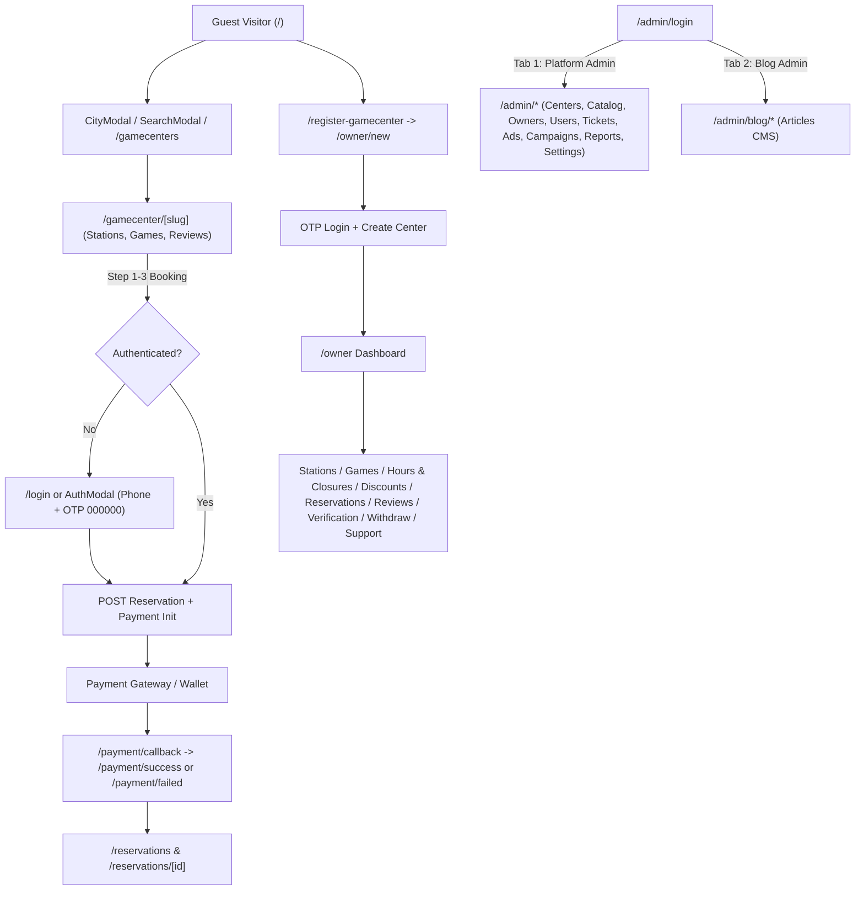

# Phase 1 — Application Discovery Report (`01-application-discovery.md`)

- **Date & Time:** 2026-11-23 18:45–18:54 (+03:30)
- **Tested Role:** Guest (Unauthenticated) + Static Code Route Map
- **Frontend Target:** `http://localhost:3000` (`/home/amir/github-projects/sayra`, Next.js 16.3.6 Turbopack)
- **Backend APIs:** `https://api.sayra-booking.ir/api/v1` (Main Platform), `https://blog.sayra-booking.ir/api` (Blog Platform)
- **Browser Session Verification:** Host-verified `BROWSER_HOST_FACTS` (`visited_origins: http://localhost:3000`, `blocked_origins: none`, latest host-verified screenshot: `final_step_46.png` archived at [phase01-admin-login-blog.png](file:///home/amir/github-projects/sayra/reports/screenshots/phase01-admin-login-blog.png)). Additional session screenshots copied and visually inspected are linked below.

---

## 1. Executive Summary of Application Structure

**Sayra (سایرا)** is a Persian RTL (`lang="fa"`, `dir="rtl"`) gaming center reservation, management, and editorial blog platform built on Next.js 16 App Router, communicating with:
1. **PlayNest / Sayra Express API** (`https://api.sayra-booking.ir/api/v1`) for gaming centers, stations, availability slots, single & group reservations, wallet, payments (Zibal/Zarinpal), notifications, tickets, verification, discounts, catalog, and platform admin.
2. **PlayNest Blog Django/DRF API** (`https://blog.sayra-booking.ir/api`) for editorial blog articles, categories, tags, series, authors, and media.

Static + live browser discovery identified **49 UI page routes** (`src/app/**/page.tsx`) and **1 server-side API proxy route** (`/api/proxy/[...path]`), spanning **5 distinct actor/role spaces** (`Guest`, `Customer`, `Owner/Manager/Staff`, `Platform Admin`, `Blog Admin`).

---

## 2. Complete Route & Page Sitemap (49 Page Routes + 1 API Route)

### A. Public & Guest-Accessible Routes (13 Routes)
| Route | Page Purpose | Live HTTP | Observed Title / H1 | Status |
|---|---|---|---|---|
| `/` | Homepage: Promo banner carousel, device categories, discounted centers, popular centers, customer CTA, Sayra network map, blog highlights, owner CTA, footer | `200` | Title: `سایرا \| Sayra - پلتفرم جامع گیمینگ سنترها` / **H1: None (`0`)** | Pass (with SEO/H1 defect) |
| `/gamecenters` | Game centers catalog with sort, device category filter, city sync, pagination (`Load More`) | `200` | H1: `گیمنت‌ها` (`۷ گیمنت` in Tabriz) | Pass |
| `/gamecenter/[id]` | Gaming center detail hub: gallery carousel, address/map/directions, device categories & stations, games + search, reviews, 3-step booking flow | `200` | H1: Center name (e.g., `گیمنت هادی`) | Pass (with UI layout/image crop issues) |
| `/gamecenters/[id]` | Legacy plural URL redirect to `/gamecenter/[id]` | `307/200` | Redirected to `/gamecenter/center-1795275702836-igt8` | Pass |
| `/login` | Unified OTP phone authentication (`UnifiedAuthForm` inside `UserLoginPanel`) | `200` | H1: `ورود یا ثبت‌نام` | Pass |
| `/register-gamecenter` | Partner onboarding landing page (steps, benefits, FAQs, CTA to `/owner/new`) | `200` | Title: `ثبت گیمنت و اتصال به سایرا...` / H1: `گیمنتت را به جهان سایرا متصل کن.` | Pass |
| `/blog` | Blog listing with search, sort, hot filter, categories, series, tags, most-viewed sidebar | `200` | Title: `وبلاگ \| سایرا` / H1: `مقاله‌های وبلاگ` | Partial Fail (`is_hot=true` API 500) |
| `/blog/[slug]` | Blog article reader (blocks: headings, TS code blocks, tables, images, tags, share, related posts) | `200` | Title: SEO title / **2 H1s** (`وبلاگ`, `بهترین مقاله سال`) | Pass (with duplicate H1 defect) |
| `/about` | About Sayra landing narrative & CTAs | `200` | Title: `درباره سایرا \| SAYRA — Enter the Universe` / H1: `بازی، فقط شروع ماجراست.` | Pass |
| `/terms` | Terms & conditions with search and 22 legal articles (`ماده ۱`–`ماده ۲۲`) | `200` | H1: `قوانین و مقررات پلتفرم گیمینگ سایرا` | Pass |
| `/support` | Support page & customer ticket management (requires login for tickets; public Telegram/WhatsApp/Rubika links) | `200` | H1: `پشتیبانی و پاسخگویی` | Pass |
| `/privacy` | **Linked from Global Footer (`حریم خصوصی`)** | **`404`** | H1: `404` — *"This page could not be found."* | **FAIL (Critical/High Broken Link)** |
| `/api/proxy/[...path]` | Next.js API proxy forwarding to `API_BASE_URL` or `BLOG_API_BASE_URL` (injects `x-api-key`) | N/A (API) | Missing `series` in `BLOG_PATH_ROOTS` (discovered in code) | Inspected |

### B. Payment Result Routes (3 Routes)
| Route | Page Purpose | Live HTTP | Observed H1 / State | Status |
|---|---|---|---|---|
| `/payment/success` | Payment success confirmation + links to `/`, `/reservations`, `/profile/wallet` | `200` | H1: `پرداخت با موفقیت انجام شد` | Pass |
| `/payment/failed` | Payment failure screen + link to `/reservations` | `200` | H1: `پرداخت انجام نشد` | Pass |
| `/payment/callback` | Gateway callback verification page (tested without query params) | `200` | **H1: None** / H2: `اطلاعات پرداخت یا رزرو جهت تأیید تراکنش یافت نشد.` | Pass (missing H1) |

### C. Customer Authenticated Routes (4 Routes — Tested in Phase 4 & Phase 2)
| Route | Purpose |
|---|---|
| `/reservations` | Customer single & group reservation list and history |
| `/reservations/[id]` | Reservation details, status timeline, route map, cancel/reschedule/proposal actions, rating trigger |
| `/profile` | Customer profile view/edit, quick stats, account actions, support phone link, logout |
| `/profile/wallet` | Customer wallet balance, charge flow, withdrawal request form, transaction history |

### D. Owner / Manager / Staff Panel Routes (13 Routes — Tested in Phase 3 & Phase 2)
| Route | Purpose |
|---|---|
| `/owner` | Owner dashboard (balance/withdrawable summary, pending reservations badge, quick booking pause card, verification banner, operation tiles; includes non-interactive `تبلیغات (به‌زودی)` tile) |
| `/owner/new` | Gaming center creation & onboarding wizard |
| `/owner/edit` | Center profile editing, gallery media upload/management, addresses, social links, site settings |
| `/owner/hours` | Weekly working schedules & temporary booking closures |
| `/owner/stations` | Gaming stations list, station edit/delete, extra controllers, and attached games |
| `/owner/stations/new` | Create station (from catalog or custom) |
| `/owner/stations/games/new` | Attach games to center/stations (`ONLINE`/`OFFLINE` play modes) |
| `/owner/reservations` | Owner incoming & historical reservations (single & group) |
| `/owner/reservations/[id]` | Owner reservation detail: confirm, cancel, reschedule, propose time, start/pause/resume/stop session |
| `/owner/discounts` | Discounts list & status toggles |
| `/owner/discounts/new` | Create percentage/fixed discount rules |
| `/owner/reviews` | Customer ratings moderation & owner replies |
| `/owner/verification` | KYC / business license verification submission & status |
| `/owner/withdraw` | Revenue/commissions & payout withdrawal request |
| `/owner/support` | Owner support tickets list & creation |
*(Note: 15 route files exist under `src/app/owner/` including `/owner/new`, `/owner/reservations/[id]`, `/owner/stations/new`, `/owner/stations/games/new`, `/owner/discounts/new`, etc.)*

### E. Platform Admin & Blog Admin Routes (17 Routes — Guard/RBAC Tested in Phase 2)
| Route | Purpose |
|---|---|
| `/admin/login` | Dual-tab login: Platform Admin (`پنل ادمین اصلی`: phone/email + password) and Blog Admin (`وبلاگ`: username + password) |
| `/admin` | Platform Admin dashboard (KPI cards, recent reservations table) |
| `/admin/gamecenters` | All gaming centers management & status approval |
| `/admin/gamecenters/[id]` | Single gaming center administrative inspection |
| `/admin/catalog` | Platform device types, device catalog, and game catalog CRUD |
| `/admin/tickets` | Platform support tickets queue & assignment |
| `/admin/owners` | Owner verification review (approve/reject) |
| `/admin/reports` | Platform analytics & financial/operations reports |
| `/admin/users` | Users/customers listing & status management |
| `/admin/users/[id]` | Single user detail, password reset, session revocation |
| `/admin/ads` | Platform advertisements & ad requests moderation |
| `/admin/campaigns` | Platform discount campaigns wizard |
| `/admin/settings` | Platform global settings & maintenance mode |
| `/admin/blog` | Blog CMS article management (uses `BLOG_ACCESS_TOKEN_KEY`) |
| `/admin/blog/new` | Create new blog post with dynamic block editor |
| `/admin/blog/[slug]/edit` | Edit existing blog post |

---

## 3. Menus, Navigation & Modal Inventory

### Navigation Bars
1. **Desktop Header (`Header.tsx` + `DesktopNav.tsx`)**:
   - Brand logo (`سایرا` -> `/`)
   - Nav items: `صفحه اصلی` (`/`), `گیمنت‌ها` (`/gamecenters`), `وبلاگ` (`/blog`), `درباره سایرا` (`/about`), `قوانین و مقررات` (`/terms`)
   - City selector button (`تبریز` -> opens `CityModal`)
   - Search bar trigger (`جست‌وجوی گیمنت، سیستم یا بازی… /` -> opens `SearchModal`, shortcut `/`)
   - Guest CTA: `ورود / ثبت‌نام` -> `/login` (Note: Notification bell and `رزروهای من` are inside a mobile-only container and hidden on desktop for guests!)
   - Authenticated Dropdown Menu (`renderAccountDropdownContent`):
     - Guest: `ورود به حساب کاربری` (`/profile`)
     - Logged-in: `اطلاعات کاربر (پروفایل)` (`/profile`), `رزروهای من` / `رزروهای گیم‌نت` (`/reservations` or `/owner/reservations`), `نوتیفیکیشن` (opens `NotificationModal`), `OwnerCenterLink` (`/owner` or `/admin` or `/register-gamecenter`), `پشتیبانی` (`/support`), `خروج از حساب کاربری`
2. **Mobile Bottom Bar (`BottomBar.tsx`, `< lg`)**:
   - 4 tabs: `خانه` (`/`), `گیمنت‌ها` (`/gamecenters`), `اخبار` (`/blog`), `حساب` (`/profile`)
   - Note: `درباره سایرا`, `قوانین و مقررات`, `پشتیبانی`, `ثبت گیمنت`, and direct `رزروهای من` are not in the 4-tab bottom bar (accessible via header or footer).
3. **Global Footer (`Footer.tsx`)**:
   - CTA: `کشف دنیای سایرا` (`/gamecenters`)
   - Group 1 (`صفحات`): `/`, `/gamecenters`, `/register-gamecenter`, `/blog`, `/about`, `/terms`
   - Group 2 (`ارتباط با ما`): `/support`
   - Trust seal: Enamad (`https://trustseal.enamad.ir/...`)
   - Bottom row: `قوانین و مقررات` (`/terms`), `حریم خصوصی` (`/privacy` — **404!**), Phone `04133332211` (`tel:04133332211`)
4. **Owner Header (`OwnerHeader.tsx`)**:
   - Back button (`/` or `/owner`), Page title + Center badge, Owner name link (`/profile`), Optional search input, `OwnerVerificationBadge` (`/owner/verification`), Notification bell (`scope="staff"`), Home button (`/`).
5. **Admin Sidebar (`AdminSidebar.tsx`) & Header (`AdminHeader.tsx`)**:
   - Collapsible sidebar with 11 items (`داشبورد`, `گیمنت‌ها`, `کاتالوگ دستگاه‌ها`, `تیکت‌ها`, `وبلاگ`, `احراز هویت`, `گزارش‌ها`, `کاربران`, `تبلیغات`, `کمپین‌ها`, `تنظیمات`).

### Modals, Drawers & Interactive Overlays (Discovered in Live UI & `src/components`)
- **Public / Customer Modals**: `CityModal`, `SearchModal`, `NotificationModal`, `AuthModal`, `UnifiedAuthModal`, `RatingModal`, `DeviceSelectModal`, `GroupBookingSheet`, `GamecenterLocationCard` (map modal), `BottomSheet` (sort sheet on `/gamecenters`), `ModalShell`, `FullScreenDialog`.
- **Owner Modals**: `OwnerAuthModal`, `GroupConfirmModal`, `GroupCancelModal`, `GroupProposeTimeModal`, `StationModals` (add/edit station, extra controllers, attach game), `QuickBookingPauseCard`.
- **Admin Modals**: `GamecenterFormModal`, `GamecenterMediaModal`, `DeleteConfirmationModal`, `BulkDeleteConfirmationModal`, `OwnerVerificationDetailModal`, `AdminCreateAdModal`, `AdRequestDetailModal`, `CampaignFormWizardModal`, `CampaignDetailsModal`, `CampaignDeleteModal`, `UserFormModal`, `BlogPostPreviewModal`, `BlogPostDeleteModal`, `TicketInfoModal`.

---

## 4. User Roles & Access Architecture

| Role | Storage / Token Scope | Primary Surfaces |
|---|---|---|
| `GUEST` | None | Public discovery, `/gamecenters`, `/gamecenter/[id]`, `/blog`, `/about`, `/terms`, `/support`, `/register-gamecenter`, `/login`, `/admin/login` |
| `USER` / `CUSTOMER` | `localStorage` (`sayra_access_token`, `sayra_refresh_token`, `sayra_user_auth`) with `actorType: "CUSTOMER"` | Customer discovery, booking creation, `/reservations`, `/reservations/[id]`, `/profile`, `/profile/wallet`, `/support` tickets, notifications |
| `OWNER` / `MANAGER` | `localStorage` main tokens with `actorType: "USER"`, `role: "MANAGER" \| "OWNER"` | All `/owner/*` management pages + customer profile/reservations |
| `STAFF` | `localStorage` main tokens with `actorType: "USER"`, `role: "STAFF"` | Scoped `/owner/*` center operations (normalized to `MANAGER` in `AuthContext.tsx`) |
| `PLATFORM_ADMIN` | `sessionStorage` (`sayra_admin_access_token`, `sayra_admin_refresh_token`, `sayra_admin_user_auth`) | `/admin/*` (excluding `/admin/blog/*`) |
| `BLOG_ADMIN` | `sessionStorage`/`localStorage` (`sayra_blog_access_token`, `sayra_blog_refresh_token`) | `/admin/blog/*` (Django Blog backend auth) |

---

## 5. High-Level User Flow Map

---

## 6. Phase 1 Live Test & Findings Log

| ID | Route / Feature | Exact Scenario | Expected Result | Actual Result | Status | Severity | Root Cause | Fix Status |
|---|---|---|---|---|---|---|---|---|
| **P1-01** | Global Footer -> `/privacy` | Click `حریم خصوصی` link in Footer | Privacy policy page renders with HTTP 200 | Returns **HTTP 404** (`This page could not be found.`) — `src/app/privacy/page.tsx` does not exist | **Fail** | **High** | Confirmed Frontend Defect (`Footer.tsx` links to missing route `/privacy`) | Open |
| **P1-02** | `/blog` (`is_hot=true` API) | Load `/blog` or filter hot articles | Hot articles endpoint returns HTTP 200 JSON | `GET https://blog.sayra-booking.ir/api/articles/?is_hot=true&ordering=-published_at&page=1&page_size=4&visibility=public` returns **HTTP 500** (`An unexpected error occurred on the server.`) | **Fail** | **High** | Confirmed Blog Backend (`PlayNest/Blog`) Defect | Open |
| **P1-03** | Homepage (`/`) Heading Hierarchy | Inspect DOM headings on `/` | Page contains one semantic `<h1>` | **`0` `<h1>` elements** found on `/` | **Fail** | **Medium** | Confirmed Frontend Defect (`HomePageClient.tsx` / hero sections omit `<h1>`) | Open |
| **P1-04** | `/blog/[slug]` Heading Hierarchy | Inspect DOM headings on `/blog/the-best-blog-post-of-year` | Single `<h1>` for article title | **2 `<h1>` tags** (`وبلاگ` in header/breadcrumb + `بهترین مقاله سال`) | **Fail** | **Medium** | Confirmed Frontend Defect (`BlogPostView.tsx` / page header) | Open |
| **P1-05** | `/payment/callback` Heading Hierarchy | Visit `/payment/callback` without params | Semantic `<h1>` error state | **`0` `<h1>` tags** (renders `<h2>` only) | **Fail** | **Low** | Confirmed Frontend Defect (`src/app/payment/callback/page.tsx`) | Open |
| **P1-06** | Global Footer -> Enamad Seal | Load homepage `/` and inspect images | Enamad logo loads cleanly | `https://trustseal.enamad.ir/logo.aspx?...` failed with `status 0` in browser network log | **Fail** | **Low** | Third-party external origin (`trustseal.enamad.ir`) unavailable/blocked | Open (External) |
| **P1-07** | `/gamecenter/[id]` Game Posters & Grid Balance | Open `/gamecenter/center-1795275702836-igt8` at `1440×900` | Game cover images show unclipped posters and station column balances well | Game covers horizontally clipped (`ER-M`, `N II`); single station card leaves large empty area on right; `گیمنت شایان÷` displays unrounded `۴۱.۶۷٪ تخفیف` | **Fail** | **Medium** | Confirmed Frontend UI/Data-Formatting Defect (`Gamecard` / `discount` rounding / station grid) | Open |
| **P1-08** | `/admin/login?tab=blog` Visual Consistency | Open `/admin/login` and switch to Blog tab | Matches Sayra dark/lime design system | Blog Admin tab uses a bright blue palette and `B` icon inconsistent with Sayra design tokens | **Fail** | **Low** | Confirmed Frontend UI Defect (`src/app/admin/login/page.tsx`) | Open |
| **P1-09** | Homepage, `/gamecenters`, `/gamecenters/[id]` redirect, Modals, `/about`, `/terms`, `/support`, `/register-gamecenter`, `/login`, `/payment/success`, `/payment/failed` | Guest navigation and modal open/close | Pages render HTTP 200, modals open/close on Escape, redirect works | All loaded HTTP 200 with zero JS console errors; `/gamecenters/[id]` redirected cleanly to `/gamecenter/[id]` | **Pass** | — | — | Verified |

### Phase 1 Evidence Screenshots
- [phase01-admin-login-blog.png](file:///home/amir/github-projects/sayra/reports/screenshots/phase01-admin-login-blog.png) *(Host-verified via `BROWSER_HOST_FACTS` `final_step_46.png`)*
- [phase01-home.png](file:///home/amir/github-projects/sayra/reports/screenshots/phase01-home.png)
- [phase01-gamecenters.png](file:///home/amir/github-projects/sayra/reports/screenshots/phase01-gamecenters.png)
- [phase01-gamecenter-detail.png](file:///home/amir/github-projects/sayra/reports/screenshots/phase01-gamecenter-detail.png)
- [phase01-blog.png](file:///home/amir/github-projects/sayra/reports/screenshots/phase01-blog.png)
- [phase01-admin-login.png](file:///home/amir/github-projects/sayra/reports/screenshots/phase01-admin-login.png)
